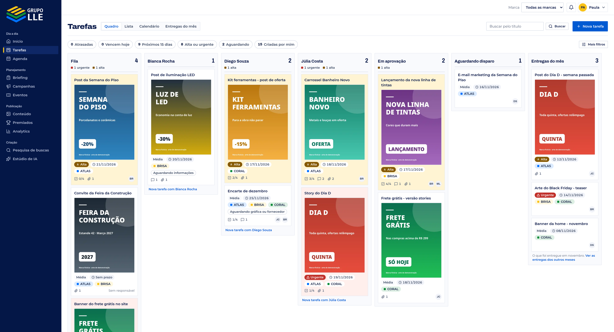

# Central de Marketing

Plataforma web multiempresa para o time de marketing do Grupo LLE, que atende as três marcas do
grupo. Desenvolvida em dupla durante o meu estágio na empresa, já é usada pelo time
de marketing no dia a dia.

> Este repositório é uma vitrine: o código fica num repositório privado da empresa. Aqui estão o
> que a plataforma resolve e, principalmente, as partes desenvolvidas por mim. No print,
> a plataforma roda localmente com dados fictícios: as marcas, as pessoas, as tarefas e as artes
> foram inventadas. Nomes de marcas, campanhas e sistemas internos foram omitidos.

---

## O problema

O trabalho do marketing estava espalhado:

- as tarefas da equipe de criação, num quadro do **Trello**;
- o planejamento do ano (campanhas, eventos e feiras), no **Monday**;
- o calendário de publicações, em **planilhas**;
- os pedidos de arte, por **WhatsApp**;
- o resultado das campanhas de vendas, **apurado à mão** em planilha, longe de quem decide.

A Central junta tudo num lugar só, com uma regra que guia o resto: **tudo se liga a uma campanha.**
A tarefa, a peça publicada e o resultado apontam para a mesma campanha, e o resultado é somado,
nunca digitado.

---

## Divisão do trabalho

Dois desenvolvedores, com o gestor de marketing como dono do produto.

- **O outro desenvolvedor** montou a base da plataforma e é dono da parte de IA (o estúdio que gera
  imagens e textos de marketing).
- **Gustavo** participou das primeiras decisões que planejaram o projeto e hoje cria e lapida
  funcionalidades: a agenda de eventos, as campanhas, o placar das campanhas de vendas, boa parte do
  quadro de tarefas, a atualização em tempo real e as tarefas que se repetem.

**Como o trabalho é feito.** Cada funcionalidade começa por uma decisão escrita (ADR), antes do
código. O método é o desenvolvimento guiado por especificação (SDD), com a skill *grill-me* no
Claude Code: a IA faz pergunta atrás de pergunta até a decisão fechar, e o que foi descartado fica
registrado com o motivo. O projeto tem mais de 50 ADRs, e elas mandam sobre qualquer outro
documento.

Antes de mudar uma tela que o time usa, protótipos de frontend são apresentados à equipe de design,
que é quem usa a plataforma. Como já nascem pensados no desenho, costumam voltar com poucas
mudanças.

---

## O que foi construído

| Funcionalidade | O que faz |
| --- | --- |
| **Agenda de eventos** | Os eventos do ano por marca: cadastro, edição, lixeira e a lista do ano com o que está planejado, em andamento ou já realizado. O que já passou aparece apagado, e o cancelado, riscado. |
| **Campanhas** | A lista agrupada por situação, com o que está valendo primeiro, a imagem de divulgação ao lado e a edição numa gaveta lateral, sem sair da lista. |
| **Placar das campanhas de vendas** | A seção Desempenho, no topo das campanhas, responde à pergunta da gestão - "como vai a campanha?": quanto faturou, quem participa e quem já atingiu o mínimo, com barras por participante. |
| **Quadro de tarefas** | Partes do quadro que substitui o Trello: o cartão, os anexos em grade com visualizador em tela inteira e zoom, "baixar todos" num `.zip`, checklists, as setas que andam entre as tarefas e o arrastar no fundo para rolar o quadro. |
| **Atualização em tempo real** | Quando um colega muda uma tarefa, a mudança chega para quem está com a Central aberta, sem F5. |
| **Tarefas que se repetem** | A tarefa semanal (a promoção de toda quinta, por exemplo) nasce sozinha na data, entregue a anterior ou não. |

---

## Decisões que valem contar

**A plataforma não calcula o placar.** As regras das campanhas de vendas já existiam num motor em
Python, parte do [Painel de Automações](https://github.com/gustavoallves/painel-de-automacoes), e a
conta precisa bater com o painel do Power BI que a diretoria vê. Refazer a conta na plataforma
deixaria a mesma regra em dois lugares, e um dia eles iam divergir. Por isso o motor apura e a
Central só guarda e mostra.

**O motor grava com o mínimo de acesso.** O banco de vendas fica dentro da rede da empresa, e a
plataforma, na nuvem, não chega até ele. Mas o caminho contrário funciona: o motor, dentro da rede,
chega à plataforma. Ele grava por uma única função no banco, com uma conta própria que só pode
gravar placar - não lê nenhuma tabela e não aparece em nenhuma lista de pessoas. Se a senha
vazar, o estrago se limita a isso. Com essa conta, a etapa intermediária planejada (exportar Excel
e importar à mão) nem precisou ser construída.

**Uma seção, não uma página.** O time reclamava que cada informação custava três cliques. O placar
ia ficar no fim da página de cada campanha; virou uma seção acima da lista, que já abre na campanha
apurada mais recente. O ano e a campanha escolhidos vão no endereço, então o link mandado no
WhatsApp abre direto no placar certo.

**Nenhum código por tipo de campanha.** Há campanhas de ranking de vendedor, de faixa de valor por
cliente e de ranking de cliente. A mesma tela serve às três, porque o que muda sai do próprio
placar: "atingiu o mínimo" é ter posição ou faixa, e a coluna de posição só aparece quando nenhuma
linha tem faixa.

**Cor nunca é o único sinal.** As barras do placar são cheias para quem atingiu e vazadas para quem
não atingiu, e o leitor de tela diz isso em cada linha. São feitas em HTML e CSS: uma regra de três
e um `div` não justificavam uma biblioteca de gráficos.

**Tempo real com a conta feita antes.** O time pediu que as mudanças dos colegas aparecessem sem
F5. Recarregar o quadro custa cerca de 0,35 MB; com 5 pessoas e 100 a 500 mudanças por dia, a tela
que se refaz sozinha passaria várias vezes da cota de tráfego do plano gratuito do banco. A
primeira versão acendia um aviso "Há mudanças", e a página só recarregava no clique, o que cabia na
cota. Quando o projeto passou para o plano pago, a tela passou a se refazer sozinha, sobre a mesma
escuta.

**Só avisa quem pode ver.** A escuta usa a sessão de quem está olhando, então o banco confere as
permissões de cada pessoa: ninguém recebe a mudança de uma marca que não é sua. Pelo mesmo motivo,
a escuta ignora exclusões, que chegam sem essa conferência e avisariam gente de outra marca.

**A tarefa repetida nasce pela data.** Antes, a próxima ocorrência só nascia quando alguém
concluía a anterior; o cartão desta quinta esperava o da quinta passada ser entregue. Passou a
nascer pela data, com um agendamento dentro do próprio banco (`pg_cron`). Os dois riscos de
agendar ficaram fechados: rodar duas vezes não duplica, porque o banco barra a mesma ocorrência na
mesma data; e um dia em que a rotina não rodou se recupera no dia seguinte.

**A tela esconde o que o papel não pode; o banco recusa.** O analista não vê botão que o banco vai
negar, mas quem decide é sempre o banco, com as permissões por linha (RLS). Esconder na tela é
experiência; a segurança de verdade fica no banco.

---

## Stack

**TypeScript** · Next.js · React · Tailwind CSS · Supabase (PostgreSQL, autenticação, Storage,
Realtime e permissões por linha) · `pg_cron` · SQL · Vercel · Claude Code

---

## Resultado

- O time de marketing usa a Central no lugar do Trello, do Monday e das planilhas.
- O placar das campanhas de vendas, que era apurado à mão, chega pronto e atualizado, na tela de
  quem decide.
- As decisões do projeto estão escritas: quem chega depois lê o porquê, não só o código.
